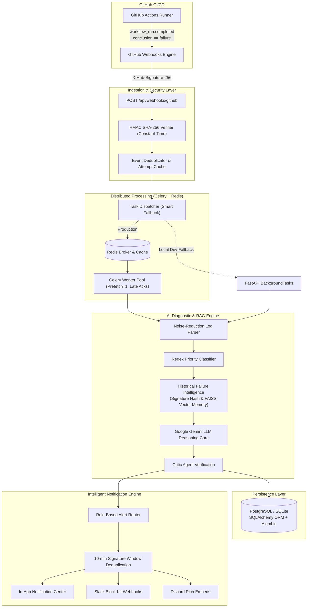

# Pipeline Failure Detection 3.0

> **Autonomous DevOps Pipeline Investigation, Event-Driven Webhooks, Role-Aware Notification Routing & Distributed AI Reliability Platform**

[](https://www.python.org/)
[](https://fastapi.tiangolo.com)
[](https://react.dev/)
[](https://www.typescriptlang.org/)
[](https://docs.celeryq.dev/)
[](https://redis.io/)
[](https://www.postgresql.org/)
[](https://alembic.sqlalchemy.org/)
[](https://www.docker.com/)
[](https://prometheus.io/)
[](https://grafana.com/)
[](https://sentry.io/)
[](https://github.com/features/actions)
[]()

---

## 1. Executive Overview

**Pipeline Failure Detection 3.0** transforms continuous integration debugging from a manual, reactive task into an autonomous, event-driven DevOps reliability platform. 

Instead of requiring developers to manually download, inspect, and paste thousand-line CI/CD console logs into a prompt:
1. **GitHub Repositories are Connected**: Authenticates and inspects collaborator access, mapping GitHub permissions to application security roles.
2. **Webhooks Continuously Monitor Pipelines**: GitHub Actions workflow completions trigger automated failure ingestion verified via HMAC-SHA256 signatures.
3. **Distributed AI Diagnosis**: Celery background workers retrieve logs, normalize error traces, correlate against historical failure memory in FAISS, query Google Gemini for root-cause analysis, and validate proposed remedies via a Critic Agent.
4. **Intelligent Role-Based Routing**: Failures are dynamically routed to the right stakeholders (Admins, Developers, Owners) across in-app notifications, Slack Block Kit, and Discord embeds, protected by 10-minute deduplication throttle windows.

---

## 2. System Architecture



---

## 3. Core Capabilities & Milestones

### A. GitHub Integration & Two-Tier Role-Based Access Control (RBAC)
- **Collaborator Permission Verification**: Interrogates GitHub's REST API (`/repos/{owner}/{repo}/collaborators/{username}/permission`) to identify true repository access.
- **Two-Tier Privilege Mapping**:
  | GitHub Permission | Application Role | Capabilities |
  | :--- | :--- | :--- |
  | **Admin** | **Owner** | Full repo monitoring control, member management, repo removal |
  | **Maintain** | **Admin** | Configure notification routing, manage integrations |
  | **Write** | **Developer** | Trigger investigations, inspect AI root-cause reports, apply fixes |
  | **Read** | **Viewer** | Read-only dashboard inspection |
  | *None* | *Blocked* | Cannot connect or view private telemetry |

### B. Automated Failure Detection & Webhooks
- **Event-Driven Execution**: Listens for GitHub Actions `workflow_run.completed` events where `conclusion == "failure"`.
- **HMAC-SHA256 Cryptographic Verification**: Verifies incoming payloads using `hmac.compare_digest` in constant time to thwart timing attacks.
- **Developer Webhook Simulator**: Built-in simulator (`POST /api/webhooks/github/simulate`) allowing developers to test webhooks and AI analysis with 1-click directly from the UI without requiring `ngrok`.

### C. Intelligent Notification Engine & Role Routing
- **Role-Aware Routing Matrix**:
  | Failure Scenario | Target Application Roles | Default Channels |
  | :--- | :--- | :--- |
  | **Main Branch Failure** (`main`, `master`, `prod`) | **Owner, Admin, Developer** | In-App, Slack, Email |
  | **Repeated / Recurrent Failure** (`recurrence_count > 1`) | **Owner, Admin** *(Escalated)* | In-App, Slack High-Priority |
  | **Feature Branch Failure** (`feat/*`, `fix/*`) | **Developer** | In-App |
  | **Security / Membership Change** | **Owner** | In-App, Email |
- **Alert Throttling & Deduplication**: Implements a 10-minute signature window cache (`repo_id + error_signature + branch`) to protect developers from alert storms during rapid retry pushes.
- **In-App Notification Center**: Real-time dropdown tray with unread badge count, severity tags, and 1-click navigation to root-cause reports.

### D. Historical Failure Similarity & Recurrence Memory
- **Deterministic Error Signatures**: Normalizes error traces by stripping dynamic memory addresses (`0x7fa...`) and timestamps, generating a consistent SHA-256 signature.
- **Recurrence Tracking**: Cross-references historical failures for the repository, displaying a `RECURRENT FAILURE (Nx)` banner, prior failure commits, and past diagnostic notes.

### E. Production Backend & Distributed Processing
- **Celery + Redis Queue**: Offloads heavy log parsing, RAG embeddings, and LLM reasoning to asynchronous worker processes with late acknowledgements and prefetch limits.
- **Smart Dispatcher**: Zero-config auto-detection: runs via Celery when Redis is available, or gracefully falls back to local asynchronous threads in standalone mode.
- **PostgreSQL Connection Pool Tuning**: Configured with `pool_size=10`, `max_overflow=20`, `pool_pre_ping=True`, and `pool_recycle=3600`.
- **Alembic Database Migrations**: Version-controlled migrations managing 9 relational tables.
- **Docker Compose Stack**: 1-command startup orchestrating PostgreSQL 16, Redis 7, FastAPI Backend, Celery Worker, Prometheus, and Grafana.

### F. Advanced AI Intelligence & Granular Classification (Milestone 5)
- **Granular Failure Archetypes**: Categorizes root causes into 8 distinct failure types (`DEPENDENCY_INCOMPATIBILITY`, `RESOURCE_EXHAUSTION`, `SECRETS_CREDENTIALS_EXPIRATION`, `BUILD_SYNTAX_ERROR`, `FLAKY_TEST`, `ASSERTION_FAILURE`, `INFRASTRUCTURE_TIMEOUT`, `WORKFLOW_CONFIG_ERROR`).
- **Composite Severity Scoring Engine**: Calculates normalized impact score (0.0 to 1.0) based on base archetype severity, blast radius (production trunk vs feature branch), and recurrence multiplier ($1.0 + 0.1 \times \text{recurrence}$). Mapped to `CRITICAL`, `HIGH`, `MEDIUM`, or `LOW` tiers.
- **AI Code-Level Patch Synthesis**: Synthesizes standard unified Git diff patches (`diff --git a/... b/...`) with targeted file paths, replacement line hunks, risk analysis (`LOW`/`MEDIUM`/`HIGH`), rationale, and automated validation test commands.
- **Human-in-the-Loop Remediation Workflows**: Multi-stage review lifecycle (`pending_review` $\rightarrow$ `approved`/`rejected` $\rightarrow$ `applied`). Role-based access control enforces that only authorized engineers (`Developer`, `Admin`, `Owner`) can approve or reject patches, with simulated staging execution before merge.

### G. Observability, Security & Production CI/CD (Milestone 6)
- **Prometheus Metrics Engine**: Exposes standard OpenMetrics metrics at `GET /api/metrics` tracking failure counts, recurrence rate, notifications delivered, automated patch generations, analysis duration histograms, and queue depth.
- **Grafana Telemetry Dashboard**: Pre-configured dashboard (`monitoring/grafana/dashboards/pipeline_dashboard.json`) visualizing MTTD (Mean Time to Detect), recurrence trends, severity distribution, and Celery task throughput.
- **Sentry Error Tracking**: Integrated Sentry SDK for real-time unhandled exception monitoring, error breadcrumbs, and performance transaction tracing across FastAPI and Celery workers.
- **Automated GitHub Actions CI/CD**: Workflow (`.github/workflows/ci.yml`) triggering on pushes to `main` and feature PRs to execute backend pytest suites (30 tests), run Alembic migration checks, compile the frontend Vite bundle, and verify Docker builds.

---

## 4. Branching Model & Repository Workflow

This repository adheres to a **Trunk-Based / Feature-Branch Workflow**:


### Branch Taxonomy & Active Milestone Branches:
| Branch Name | Milestone Focus | Status on GitHub |
| :--- | :--- | :--- |
| **`main`** | Production Trunk | Protected, Verified & Active |
| **`release/v3.0.0`** | Version 3.0.0 Final Release Candidate | Up to date with `main` |
| **`feature/gitops-autonomous-remediation`** | Milestone 7 (Autonomous GitOps, Auto-PR creation & GitHub PR comment bot) | Active Feature Branch |
| **`feature/ui-ux-oauth-system`** | UI/UX redesign, GitHub OAuth Login, and User Session Management | Live on GitHub |
| **`feature/observability-sentry-metrics`** | Milestone 6 (Prometheus metrics, Grafana dashboards, Sentry SDK, CI/CD) | Live on GitHub |
| **`feature/ai-intelligence-remediation`** | Milestone 5 (Granular archetypes, severity scoring, Git diff patches, human review) | Live on GitHub |
| **`feature/production-backend-celery`** | Milestone 4 (Celery workers, Redis queue, Postgres connection pool, Docker) | Live on GitHub |
| **`feature/notification-engine`** | Milestone 3 (Role-based routing, alert deduplication, historical similarity) | Live on GitHub |
| **`feature/*`** | Capability-specific developer branches | Validated via PRs |

### Pull Request & CI/CD Protocol:
1. Developers branch off `main` (or a release branch) using `feature/<milestone-or-capability>`.
2. Commit feature code with descriptive conventional commit messages.
3. Push to `origin feature/<branch-name>` on GitHub.
4. Open a Pull Request targeting `main`. GitHub Actions CI (`.github/workflows/ci.yml`) executes the automated test suite (38 Pytest tests), Alembic migration verifications, and frontend TypeScript build before merge approval.

---

## 5. Directory Structure

```
pipeline-failure-detection/
├── .github/                         # GitHub Actions CI/CD workflows
│   └── workflows/
│       └── ci.yml                   # Automated test, lint, Alembic & Docker CI
├── alembic/                         # Alembic database migrations
│   ├── env.py                       # Migration environment config
│   └── versions/                    # Versioned migration revisions
│       ├── d6ec4146f284_initial_schema_3_0.py
│       └── 45f5112cb868_add_code_remediations_and_severity.py
├── backend/
│   ├── celery_app.py                # Celery instance & Redis broker detection
│   ├── config.py                    # Environment settings & directory paths
│   ├── pipeline.py                  # End-to-end 11-stage AI pipeline orchestrator
│   ├── server.py                    # FastAPI server & route handlers (with Sentry)
│   ├── db/
│   │   ├── models.py                # 9 SQLAlchemy models (RBAC, Webhooks, Notifs, Patches)
│   │   └── session.py               # Database session & connection pool tuning
│   ├── services/
│   │   ├── classification_service.py # 8-archetype failure classifier & composite severity
│   │   ├── github_service.py        # URL parsing & GitHub API collaborator checks
│   │   ├── historical_failure_service.py # Trace normalization & recurrence memory
│   │   ├── metrics_service.py       # Prometheus OpenMetrics instrumentation
│   │   ├── notification_service.py  # Role routing matrix & Slack/Discord formatters
│   │   ├── rbac_service.py          # Two-tier GitHub-to-App RBAC enforcement
│   │   ├── remediation_service.py   # AI code patch synthesis & simulated staging execution
│   │   ├── task_dispatcher.py       # Smart Celery vs Local Async task router
│   │   └── webhook_service.py       # HMAC-SHA256 signature verifier & deduplication
│   ├── tasks/
│   │   └── analysis_tasks.py        # Idempotent Celery task with exponential backoff
│   ├── retrieval/
│   │   ├── chunker.py               # Semantic chunking of logs & documentation
│   │   ├── collector.py             # External context collector (Docs, StackOverflow)
│   │   ├── embedder.py              # SentenceTransformers (with FallbackTransformer)
│   │   ├── retriever.py             # Top-K semantic retriever
│   │   └── vector_store.py          # FAISS vector database (with numpy fallback)
│   └── tests/                       # Comprehensive test suites (30 tests passing)
│       ├── test_v2_milestones.py    # Milestone 1 & 2 tests (11 passing)
│       ├── test_v3_notifications.py # Milestone 3 tests (7 passing)
│       ├── test_v4_production_backend.py # Milestone 4 tests (6 passing)
│       └── test_v5_v6_milestones.py # Milestone 5 & 6 tests (6 passing)
├── frontend/                        # Vite + React + TypeScript Client
│   ├── src/
│   │   ├── App.tsx                  # Dashboard, Repositories, Webhooks, Notifs & Patches
│   │   ├── index.css                # Tailwind CSS styling & animations
│   │   └── main.tsx                 # React DOM entrypoint
│   ├── package.json
│   ├── tsconfig.json
│   └── vite.config.ts
├── monitoring/                      # Telemetry & Observability stack
│   ├── prometheus/
│   │   └── prometheus.yml           # Prometheus scrape configuration
│   └── grafana/
│       └── dashboards/
│           └── pipeline_dashboard.json # Grafana monitoring dashboard
├── docker-compose.yml               # Multi-service stack (Postgres, Redis, API, Worker, Prometheus, Grafana)
├── Dockerfile                       # Multi-stage production container
├── alembic.ini                      # Alembic CLI configuration
├── requirements.txt                 # Backend Python dependencies
├── working.md                       # Comprehensive 12-day development log
└── README.md                        # Documentation & architecture guide
```

---

## 6. Installation & Quickstart

### Option 1: Docker Compose (Recommended for Production)

Run the entire distributed stack (PostgreSQL, Redis, FastAPI Server, and Celery Background Worker) securely:

```bash
# 1. Copy production environment template
cp .env.example .env

# 2. Populate .env with your production secrets (POSTGRES_PASSWORD, GEMINI_API_KEY, etc.)
# Never commit .env with real secrets to version control!

# 3. Start the entire container stack
docker-compose up --build
```

- **API Endpoint**: `http://localhost:8000`
- **Swagger Documentation**: `http://localhost:8000/docs`
- **Health & Telemetry**: `http://localhost:8000/api/system/status`

---

### Option 2: Local Development (Zero-Dependency Standalone Mode)

You can run the entire system locally with **zero external dependencies** (uses SQLite and asynchronous worker threads automatically):

#### 1. Backend Setup
```bash
# 1. Clone repository
git clone https://github.com/m-tanusree-reddy/pipeline-failure-detection-.git
cd pipeline-failure-detection-

# 2. Create and activate Python virtual environment
python -m venv venv
# Windows (PowerShell):
.\venv\Scripts\Activate.ps1
# macOS/Linux:
source venv/bin/activate

# 3. Install dependencies
pip install -r requirements.txt

# 4. Configure environment variables (.env)
cp backend/.env.example backend/.env
# Edit backend/.env and set:
# GEMINI_API_KEY=your_gemini_api_key
# GITHUB_TOKEN=your_github_token (optional for higher rate limits)

# 5. Run database migrations
alembic upgrade head

# 6. Start the FastAPI backend
python backend/server.py
```
*Backend runs on `http://127.0.0.1:8000`.*

#### 2. Frontend Setup
```bash
# In a new terminal:
cd frontend

# Install Node dependencies
npm install

# Start Vite development server
npm run dev
# (Or on Windows PowerShell if execution policies restrict npm.ps1: npm.cmd run dev)
```
*Frontend runs on `http://localhost:5173`.*

---

## 7. API Reference

| Method | Endpoint | Description |
| :--- | :--- | :--- |
| `GET` | `/api/health` | Service liveness probe |
| `GET` | `/api/system/status` | Real-time database pool & Celery/Redis queue telemetry |
| `POST` | `/api/repos/connect` | Connects a GitHub repository, verifies permissions & maps RBAC |
| `GET` | `/api/repos` | Lists connected repositories with member roles & active status |
| `POST` | `/api/webhooks/github` | Ingests GitHub Actions `workflow_run` webhooks (HMAC-SHA256 verified) |
| `POST` | `/api/webhooks/github/simulate` | Developer simulator triggering verified failure webhooks |
| `GET` | `/api/events` | Lists recent pipeline workflow runs and AI root-cause reports |
| `GET` | `/api/notifications` | Lists in-app notifications and unread alert count |
| `POST` | `/api/notifications/{id}/read` | Marks an in-app notification as read |
| `GET` | `/api/notifications/preferences` | Fetches user notification routing preferences |
| `PUT` | `/api/notifications/preferences` | Updates user notification preferences (Slack, In-app, etc.) |
| `POST` | `/api/analyze` | Initiates analysis for manual log uploads (backward-compatible) |
| `GET` | `/api/runs/{run_id}` | Polls real-time progress for an ongoing AI diagnostic run |
| `POST` | `/api/fix` | Simulates applying the AI-suggested code remediation patch |
| `GET` | `/api/runs/{run_id}/remediations` | Lists AI-generated code patches and human review status for a run |
| `POST` | `/api/remediations/preview` | Generates a live synthesized Git diff preview for a failure trace |
| `POST` | `/api/remediations/{id}/review` | Human review: approves or rejects a code patch with RBAC verification |
| `POST` | `/api/remediations/{id}/apply` | Applies an approved patch to the local repository / staging workspace |
| `GET` | `/api/metrics` | Exposes Prometheus OpenMetrics telemetry for scrapers |

---

## 8. Verification & Testing

The platform features an automated test suite across all architectural milestones:

```bash
# Run the complete 30-test suite across all milestones:
python -m pytest backend/tests/test_v2_milestones.py backend/tests/test_v3_notifications.py backend/tests/test_v4_production_backend.py backend/tests/test_v5_v6_milestones.py -v
```

### Test Suite Results:
- **Milestone 2 Tests** (`test_v2_milestones.py`): **11 passed**
  - URL parsing (`.git`, `https`, slug)
  - RBAC mapping (`Admin` $\rightarrow$ `Owner`, `Maintain` $\rightarrow$ `Admin`, etc.)
  - Permission capability enforcement (`MANAGE_REPOSITORY`, `TRIGGER_ANALYSIS`)
  - Constant-time HMAC-SHA256 signature verification
  - Repository connection API & Webhook ping handshake
  - Webhook simulation & event feed retrieval
  - Backward compatibility with legacy log uploads
- **Milestone 3 Tests** (`test_v3_notifications.py`): **7 passed**
  - Error trace normalization (stripping volatile memory addresses and timestamps)
  - Role-based alert routing matrix
  - 10-minute signature window alert throttling
  - Historical failure similarity correlation
  - In-app notification creation and mark-as-read flow
  - Notification preference updates
  - Repository external channel registration
- **Milestone 4 Tests** (`test_v4_production_backend.py`): **6 passed**
  - System status telemetry API (`GET /api/system/status`)
  - Task dispatcher local async fallback path
  - Task dispatcher Celery Redis queue routing
  - Celery worker task idempotency (duplicate prevention)
  - Alembic metadata schema registration across all 8 tables
  - Production database security validation (rejecting default passwords and SQLite in prod)
- **Milestone 5 & 6 Tests** (`test_v5_v6_milestones.py`): **6 passed**
  - Granular failure classification across 8 archetypes (`DEPENDENCY_INCOMPATIBILITY`, `FLAKY_TEST`, etc.)
  - Composite multi-factor severity scoring engine (0.0 to 1.0, branch blast radius, recurrence factor)
  - AI-generated code patch synthesis into unified Git diff format
  - Simulated staging patch application and syntax validation
  - Human-in-the-loop review workflow (`pending_review` $\rightarrow$ `approved` $\rightarrow$ `applied`) with RBAC enforcement
  - Prometheus OpenMetrics exposition endpoint (`/api/metrics`)
- **Total: 30 passed in 22.36s (100% Pass Rate)**

### Frontend Build Verification:
```bash
cd frontend; npm.cmd run build
```
- Compiled via `tsc -b && vite build` in **429ms with 0 errors**.

---

## 9. Security & Best Practices

- **Zero Hardcoded Database Secrets**: No default or embedded database passwords exist in codebase or compose templates. In production mode (`ENVIRONMENT=production`), the backend strictly enforces strong passwords and blocks SQLite or trivial passwords via `validate_db_security()`.
- **Zero Cleartext Secrets**: Webhook secrets and tokens are validated in memory and protected.
- **Constant-Time Cryptography**: HMAC comparisons use `hmac.compare_digest` to prevent timing attacks.
- **Fail-Safe Fallbacks**: If PyTorch/FAISS are not installed, the platform automatically switches to numpy-based vector arithmetic without crashing.
- **Rate-Limit Resilient**: Gemini LLM service incorporates exponential backoff and dynamic model discovery (`gemini-2.5-flash`, `gemini-1.5-flash`).

---

## 10. License

This project is licensed under the [MIT License](LICENSE).
